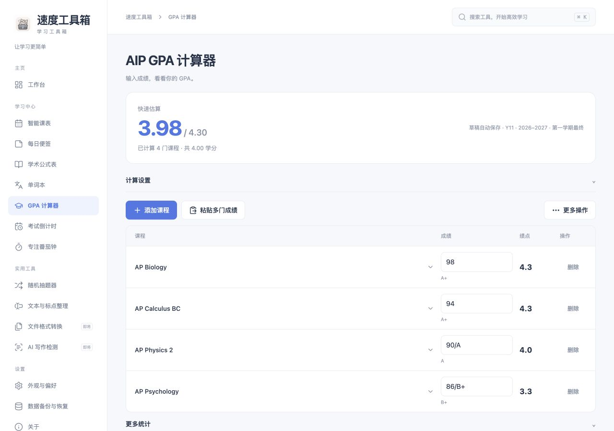

# GPA 极简改版验收

本次仅调整 GPA 页面、输入交互和必要保存逻辑。`src/utils/gpa.ts` 计算引擎、官方评分表及课程学分数据库未修改。

## 实际检查

- 类型检查及正式网页构建成功，13 个测试文件共 87 项测试通过。
- 保留全部原有换算边界、加权、学校等级优先、3.60 官方算例与期中排除测试。
- 新增输入解析、课程匹配、设置继承、规范名称去重及草稿备份校验测试。
- 增加 GPA 两位小数显示的浮点尾差测试；例如 4.3、4.3、4.0、3.3 等学分平均后显示 3.98，不因二进制尾差显示成 3.97。仅修正显示，不修改计算引擎或存储值。
- 新增真实 IndexedDB 支持的界面交互测试：连续添加四门课程、列表改分、刷新恢复、批量预览、未知课程补信息、重复提交、字母等级差异、课程详情、显式保存及同名记录保留/确认更新。
- 草稿、正式成绩和计算设置一起导出为备份格式，再校验恢复，确认两份分数独立保留。数据库仍为原 schema 1，新字段为可选；旧备份兼容。
- 浏览器实际选择 AP Biology、输入 98，显示 A+ / 4.3；批量导入 Calculus BC、Physics 2，Psychology 未匹配时要求补充类型和学分。
- 浏览器列表将 Calculus BC 从 88 改为 94，结果即时更新；刷新后仍保留。切换 Y12 后刷新仍为 Y12，切回 Y11 可见原四门草稿，未搬动或删除记录。
- 实际检查桌面、390px 手机和深色主题。手机页面宽度及视口均为 390px，无页面横向溢出；选择框统一使用本地 CSS 样式。
- 离线检查脚本通过：77 个预缓存资源存在，应用壳与资源缓存、外部来源及旧缓存隔离符合原策略。

## 场景对应

| 场景 | 结果 |
| --- | --- |
| A 快速计算 | 搜索课程、填成绩、确认添加，自动识别类别及学分 |
| B 多门成绩 | 每门加入后重算，只显示一个当前 GPA |
| C 批量输入 | 已知课程直接确认，未知项补齐前禁止导入，重复/错误行可见 |
| D 修改成绩 | 列表直接改分；无效文本提示且不覆盖上次有效记录 |
| E 专业使用 | 课程详情可改类型、学分、等级；更多操作、统计及历史可用 |
| F 刷新恢复 | 草稿及设置恢复；草稿编辑不写入正式成绩，同名正式成绩更新需勾选确认 |

截图采用合成验收成绩，Psychology 类别和学分由验收时手动指定，不是新增官方课程数据，也不是默认演示记录。

[手机截图](screenshots/gpa-simple-mobile.png)

UI 改版阶段未更新已发布的 GitHub Release。后续已生成本地 v1.1.1 Mac 安装包，详情见 [Mac 构建记录](MACOS-v1.1.1-QA.md)。没有组织真实学生的 30 秒计时试用；30 秒是本次设计目标，不是已测得的用户指标。
