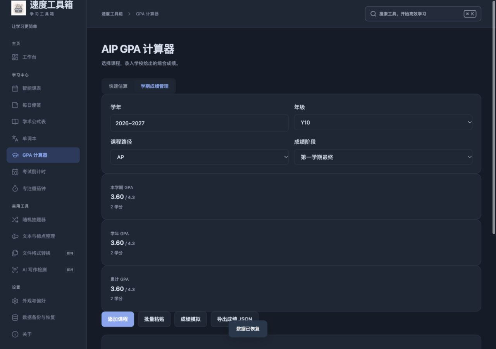

# v1.1.0 验收 · 2026-11-07

## 已执行

- TypeScript 类型检查、Vite 正式构建成功；11 个测试文件共 76 项测试通过。
- GPA 覆盖三类全部分界点及边界下小数、H 无 D-、无效/空/零成绩、零学分、Pass/Fail、加权、跨学年、期中排除、手动学校等级、重复 ID、旧备份及成绩恢复。
- 浏览器实际批量输入学校公开政策中的三门示例，识别 H/P/H 和 1/0.5/0.5 学分，显示 3.60；重复行和无法解析行有提示。刷新后记录保持；模拟 87→94 并重新换算后为 3.90，保存记录未改。
- 浏览器实际导出全量 JSON、选择该文件、核对 3 条成绩并恢复，仍显示 3.60。只在独立测试地址操作，未覆盖原网页数据。
- 检查五步向导的前进、返回、跳过、完成和设置重开，关于旧路由跳转，音乐“下一句”、新 Logo 和深色页面。
- 390px 手机 GPA 页面修正后，页面宽度与视口均为 390px，无页面横向溢出；成绩明细表可在自身区域滚动。
- 离线缓存脚本：77 项预缓存存在，子目录导航、离线静态资源及缓存隔离检查通过。该脚本为模拟环境，不等同于所有浏览器实际断网测试。
- 本机实际构建 Tauri arm64 APP 与 DMG；版本 1.1.0；代码签名完整性及 DMG 校验通过。安装包图标与新图标源文件校验值一致。
- 实际启动及退出重开桌面版，页面来源为 `tauri://localhost`，独立打包资源可用；原有课表、历史便签、单词和专注记录仍可读取。打开课表、番茄钟、词库、关于与 GPA；桌面快速录入测试 98/A+ 显示 4.30，未将测试估算保存到个人成绩中。
- 发布前扫描源码、网页构建与 136 个历史文件版本的常见凭证格式，未命中；检查历史文件列表和仓库截图，未见真实学生成绩。政策原图和个人备份不纳入仓库。原有课表预设含教师、课程和教室，不含学生名单。

## 限制

- 未在另一台 Mac、Intel Mac 或所有浏览器进行实际测试，未模拟关闭整机网络；应用本地资源由包内提供，CSP 限制远程连接。
- 没有 Apple Developer 身份签名或公证，分发可能出现 Gatekeeper 提示；支持 Apple Silicon / macOS 14+。
- GPA 基于提供的学校政策，额外曲线调整不作推断，实际以学校成绩单为准。
- 文件转换、AI 写作检测仍为敬请期待。敏感信息扫描不能替代持续人工审查；发布物不包含本机应用数据目录。

示例界面（使用学校政策算例，不是真实学生成绩）：

